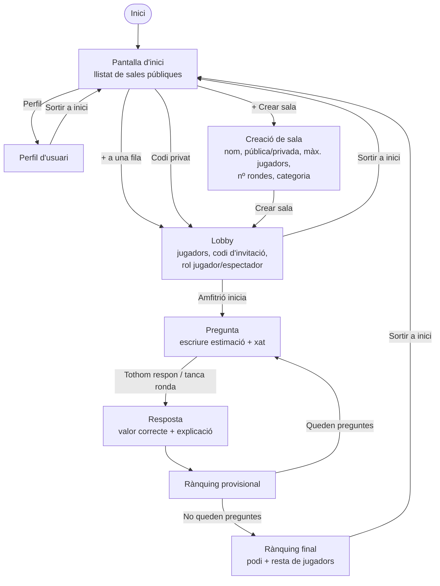
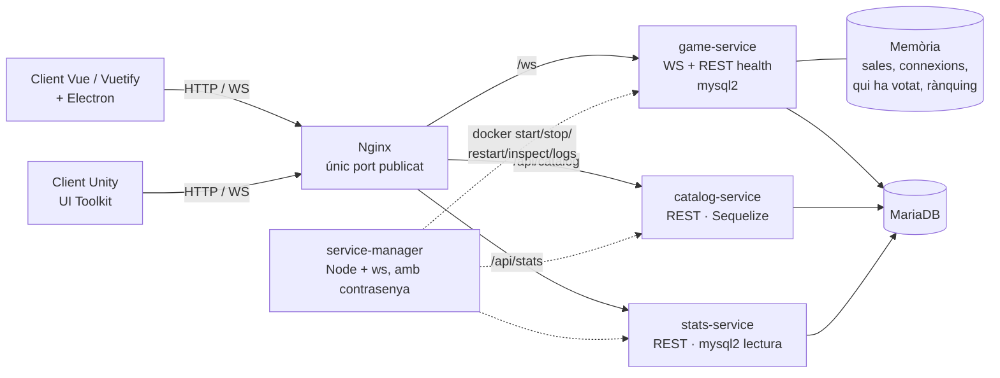
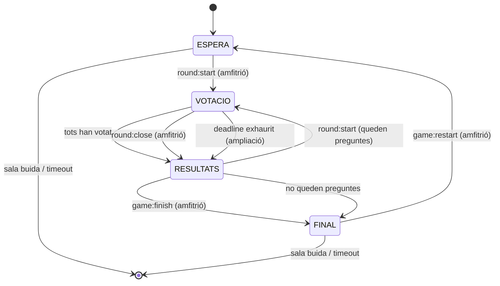
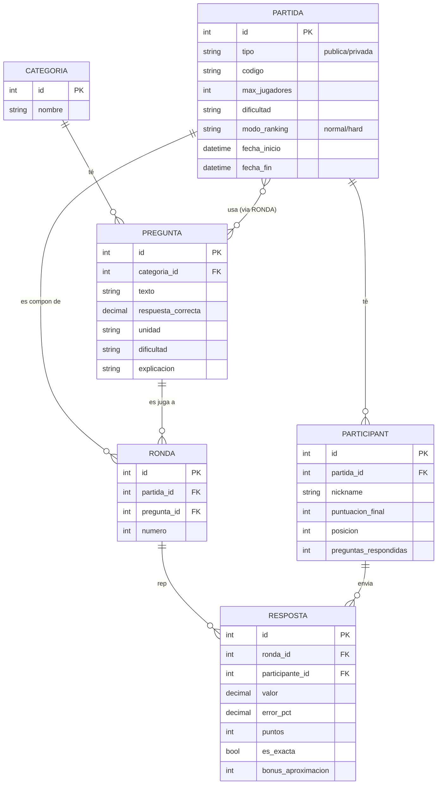
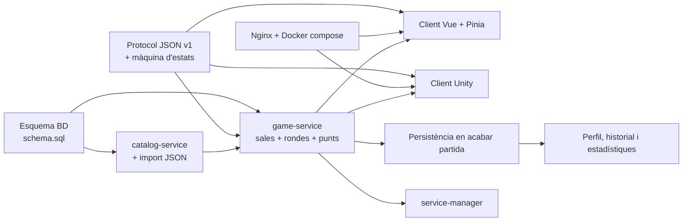

# HOW MUCH?! LIVE

Joc multijugador d'estimació numèrica en temps real. Una sala de jugadors rep una pregunta amb resposta numèrica (p. ex. *«Quants km mesura el riu Nil?»*), tothom envia la seva estimació en secret, i guanya qui s'hi acosta més.

**Stack:** Node.js + Express + `ws` · MariaDB/MySQL · Vue/Vuetify (+ Electron) · Unity UI Toolkit · Docker + Nginx.

> **Idea que ho lliga tot:** el client no decideix res. Valida, puntua i canvia d'estat només el servidor; el client envia intencions i pinta el que rep.

## Índex

1. [Visió del projecte](#1-visió-del-projecte)
2. [Disseny UX/UI](#2-disseny-uxui)
3. [Arquitectura i comunicació](#3-arquitectura-i-comunicació)
4. [Accés a dades](#4-accés-a-dades)
5. [Product Backlog](#5-product-backlog)

---

## 1. Visió del projecte

### 1.1. Definició de l'MVP

L'MVP (MVP 0) és el mínim que permet jugar una partida completa entre diverses persones:

- Entrar amb un **nickname** (sense registre; els usuaris registrats són una ampliació).
- **Crear una sala** (pública o privada amb codi), triant categoria, nombre de rondes i màxim de jugadors.
- **Unir-se** a una sala pública des del llistat, o a una privada mitjançant codi.
- **Lobby** amb la llista de jugadors connectats.
- Jugar **rondes de preguntes numèriques**: tothom envia una estimació, el servidor tanca la ronda, revela la resposta correcta i puntua.
- **Rànquing provisional** després de cada ronda i **rànquing final** amb podi.
- Guardar la partida acabada a la base de dades.
- Un sol protocol JSON compartit per als dos clients (Vue/Electron i Unity) contra el mateix `game-service`.

### 1.2. Decisions sobre la mecànica de joc

| Decisió | Detall |
| --- | --- |
| Tipus de pregunta | Resposta **numèrica** amb unitat (`km`, `m`…), dificultat (`facil`, `media`…) i una explicació que es mostra en revelar. |
| Respostes secretes | Cada jugador envia **una sola estimació per ronda**. El servidor mai envia la resposta correcta ni els valors dels altres abans de la revelació. |
| Tancament de ronda | Quan han respost tots els participants connectats, quan l'amfitrió tanca la ronda, o (ampliació) quan s'acaba el temps. |
| Puntuació per posició | Posició = 1 + nombre de jugadors amb distància **estrictament menor**. Els empats comparteixen posició. Punts: 1r = 3, 2n = 2, 3r = 1, resta = 0. |
| Resposta exacta | Distància = 0 → **+2 punts** addicionals. |
| Sales | **Públiques** (apareixen al llistat) o **privades** (accés per codi, p. ex. `K7Q2`). Màxim de jugadors configurable. |
| Categories | Cada sala tria una categoria; **«Mix»** barreja totes (no és una fila de la taula: `categoria_id = NULL` i `es_mix = true`). |
| Entrada a la partida | Només es pot entrar a l'estat **ESPERA**. Qui es reconnecta fa `room:sync`, que funciona a qualsevol estat. |
| Amfitrió | Qui crea la sala. Si marxa, el rol es transfereix al següent jugador connectat. |
| Preguntes úniques | No es repeteix cap pregunta dins d'una mateixa partida. |
| Durada de l'estat | Mentre la partida és en curs tot viu en memòria; en acabar es desa a BD en una sola transacció. |

### 1.3. Funcionalitat avançada seleccionada (stretch goal)

>  **Pendent de confirmar per l'equip.** Els documents de partida recullen diverses ampliacions candidates; cal triar-ne una com a stretch goal principal i marcar-la aquí.

Ampliacions ja previstes a l'arquitectura i a la BD (no canvien el sobre del protocol, només afegeixen taules i camps):

- Estadístiques d'encerts, errors i precisió mitjana; rànquing global i evolució de puntuacions.
- Usuaris registrats, perfil personalitzable i assoliments.
- Comodins (amb límit diari de 2 en Solo Player), com «Canvi de pregunta».
- Contrarellotge (temporitzador de ronda) i mode de rànquing *hard*.
- Espectadors, xat de sala, expulsió de jugadors.
- Reconnexió amb token i punts conservats.

---

## 2. Disseny UX/UI

### 2.1. Diagrama de flux d'usuari



### 2.2. Wireframes de les pantalles de Vue/Vuetify

>  **Pendent:** no hi ha wireframes de Vue/Vuetify als documents de partida. Es proposa reutilitzar les mateixes 8 pantalles que Unity (mateixos fluxos i mateix protocol) adaptades a components Vuetify:
>
> | Pantalla | Components Vuetify previstos |
> | --- | --- |
> | Inici | `v-data-table` (sales públiques), `v-btn` (+), `v-text-field` (codi privat) |
> | Crear sala | `v-text-field`, `v-btn-toggle` (pública/privada), `v-select` (categoria, jugadors, rondes) |
> | Lobby | `v-list` (jugadors), `v-chip` (codi), `v-btn-toggle` (jugador/espectador) |
> | Pregunta / Resposta | `v-card`, `v-text-field type=number`, `v-navigation-drawer` (xat) |
> | Rànquing provisional / final | `v-list`, podi amb `v-card` |
> | Perfil | `v-card`, `v-data-table` (historial) |
>
> Afegiu aquí els esbossos quan estiguin fets (`docs/img/vue-*.png`).

### 2.3. Wireframes de les pantalles de Unity UI Toolkit

#### Pantalla d'inici


- `Button` per entrar al perfil · `Label` «Sala pública» · `ScrollView` amb taula de sales (nom, nº jugadors, tipus de preguntes) i botons **+** per unir-se a cada fila.
- `Label` «Crear sala» + `Button` **+**.
- `Label` «Sala privada (codi)» + `TextField` per al codi · `Label` «Nom sala» + `TextField`.

#### Creació d'una sala


- `TextField` nom de la sala · `Buttons` pública/privada · `TextField`/`Dropdown` màx. jugadors, nº rondes i categoria.
- `Button` Sortir a inici · *(falta a la imatge)* `Button` Crear sala.

#### Lobby (sala)


- `Label` + `TextField` nom de sala · `ScrollView` «Jugadors connectats».
- `Label` «Codi invitació» (p. ex. `I78X55`, només en privades) · `Buttons` jugador/espectador · `Button` Sortir a inici.
- *(Falten a la imatge)* botó per expulsar jugador, indicador de «Temps restant» per començar, botó Crear sala.

#### Pantalla de pregunta


- `Label`/`TextField` amb la pregunta · `TextField` per a la resposta · `ScrollView` de xat · `Button` Sortir a inici.
- *(Falten a la imatge)* `TextField` per escriure al xat i `Button` Enviar resposta.

#### Pantalla de resposta


- Enunciat de la pregunta · «Resposta correcta» · panell de xat · `Button` Sortir a inici.

#### Rànquing provisional


- `ScrollView` amb posició i nom/puntuació (1r, 2n, 3r…) · panell de xat · `Button` Sortir a inici.

#### Rànquing final


- `VisualElement` de **podi** (1r, 2n, 3r) · `ScrollView` «restant de jugadors» (4t, 5è…) · panell de xat · `Button` Sortir a inici.

#### Perfil d'usuari


- Nickname · Partides jugades · Victòries (top 1) · Mitjana d'encerts · Podi (top 2, top 3) · `ScrollView` «Historial partides» · `Button` Sortir a inici.

### 2.4. Esbós de l'estructura de l'Store de Pinia

>  **Proposta d'esborrany**  El client només guarda el que rep del servidor i pinta; no calcula punts ni transicions.

```text
stores/
├── useConnectionStore   ← WebSocket
│     state:   socket, status ('connecting'|'open'|'closed'), lastError
│     actions: connect(), send(type, payload), handleMessage(msg)
│
├── usePlayerStore       ← identitat local
│     state:   playerId, nickname, role ('host'|'player'|'spectator')
│     actions: setNickname(), setRole()
│
├── useRoomStore         ← sala actual (reflecteix room:state)
│     state:   code, state ('ESPERA'|'VOTACIO'|'RESULTATS'|'FINAL'),
│              players[], hostId, config{categoria, rondes, maxJugadors}
│     getters: isHost, playersConnected
│     actions: createRoom(), joinRoom(code), leaveRoom(), syncRoom(), configRoom()
│
├── useRoundStore        ← ronda en curs
│     state:   roundId, number, question{text,unit,category}, deadline,
│              progress{answered[],pending[]}, myAnswer, revealed{correctValue,results[]}
│     actions: startRound(), submitAnswer(value), closeRound()
│
├── useLeaderboardStore  ← classificació
│     state:   standings[], finalStandings[]
│
├── useChatStore         ← (ampliació) missatges de la sala
└── useLobbyStore        ← llistat de sales públiques (REST)
```

---

## 3. Arquitectura i comunicació

### 3.1. Diagrama general del sistema

Un sol punt d'entrada: els dos clients només coneixen **Nginx**, que separa el tràfic REST (`/api`) del WebSocket (`/ws`, amb la capçalera `Upgrade`). El port de Node mai queda exposat.



| Servei | Responsabilitat | Protocol | Estat propi | Capa de dades |
| --- | --- | --- | --- | --- |
| `nginx` | Entrada única, TLS, separa `/ws` i `/api` | HTTP/WS | — | — |
| `game-service` | Joc en temps real: sales, rondes, punts | WS + REST (health) | sales, connexions, qui ha votat | mysql2 (pool + transaccions) |
| `catalog-service` | CRUD categories/preguntes, import JSON | REST | cap | Sequelize |
| `stats-service` | Historial, export CSV, estadístiques | REST | cap | mysql2 (només lectura) |
| `db` (MariaDB) | Persistència duradora | SQL | — | — |
| `service-manager` | Arrenca/atura/reinicia/inspecciona contenidors | WS (amb contrasenya) | cap | — |

Decisions clau:

- **Una sola API per als dos clients.** Unity i Electron parlen amb el mateix `game-service`: un sol registre de sales i un sol càlcul de punts.
- **`game-service` és un contenidor únic (`replicas: 1`).** Les sales són estat mutable en memòria; repartir-les en rèpliques exigiria Redis pub/sub (fora d'abast). `catalog-service` i `stats-service` sí que es poden escalar.
- **Broadcast selectiu per sala**, mai global (`Map<roomCode, Set<WebSocket>>`).
- Si el contenidor de `game-service` es reinicia, **les sales en curs es perden**; només es conserva el que ja és a MariaDB.
- **Mateixa topologia en local i producció** (`docker-compose.yml` + overlay `docker-compose.prod.yml`): només canvien ports, TLS (`ws://` → `wss://`) i secrets.

| | Local | Producció |
| --- | --- | --- |
| Port publicat | `8080:80` | `80:80` i `443:443` |
| Protocol client | `http://` + `ws://` | `https://` + `wss://` (Let's Encrypt) |
| Codi de l'app | bind mount + nodemon | imatge construïda |
| Secrets | `.env.local` | `.env.prod` / secrets fora del repo |

Configuració imprescindible de Nginx per al WebSocket:

```nginx
# context http
map $http_upgrade $connection_upgrade { default upgrade; '' close; }

# location /ws
proxy_pass http://game-service:3000;
proxy_http_version 1.1;
proxy_set_header Upgrade $http_upgrade;
proxy_set_header Connection "upgrade";
proxy_read_timeout 3600s;
proxy_send_timeout 3600s;
```

#### Gestor de microserveis (`service-manager`)

Rep ordres per WebSocket i les tradueix en comandes `docker` amb `spawn()` (mai `shell: true`), en local o en remot per SSH. Només accepta una **llista tancada** d'accions i serveis (definits a `services.json`; el host mai ve del client) i exigeix contrasenya.

| Acció | Ordre Docker |
| --- | --- |
| `iniciar` | `docker start <contenidor>` |
| `parar` | `docker stop <contenidor>` |
| `reiniciar` | `docker restart <contenidor>` |
| `estat` | `docker inspect -f "{{.State.Status}}" <contenidor>` |
| `logs` | `docker logs --tail 30 <contenidor>` |

### 3.2. Protocol WebSocket (primera versió)

Tots els missatges comparteixen el mateix **sobre (envelope)**:

```json
{
  "v": 1,
  "id": "c-42",
  "type": "round:answer",
  "payload": { "roundId": "r-7", "value": 40075 },
  "ts": 1730000000123
}
```

| Camp | Tipus | Obligatori | Descripció |
| --- | --- | --- | --- |
| `v` | integer | sí | Versió del protocol (ara `1`). |
| `id` | string | sí | Identificador únic del missatge (`c-42`, `s-17`). |
| `type` | string | sí | Esdeveniment en format `àmbit:acció`. |
| `payload` | object | no | Dades de l'esdeveniment (`{}` si no cal res). |
| `ts` | integer | sí | Timestamp Unix en ms. |

Respostes especials:

```json
{ "v": 1, "type": "ack",   "replyTo": "c-42", "ts": 1730000000124 }
{ "v": 1, "type": "error", "replyTo": "c-42",
  "payload": { "code": "ROUND_CLOSED", "message": "La ronda ja està tancada." }, "ts": 1730000000125 }
```

#### Client → Servidor

| `type` | Qui pot | `payload` | Efecte |
| --- | --- | --- | --- |
| `room:create` | tothom | `{ "playerName": "Anna" }` | Crea sala; l'emissor és amfitrió. Retorna `roomCode` i `playerId`. |
| `room:join` | tothom | `{ "roomCode": "K7Q2", "playerName": "Biel" }` | Incorpora el jugador (nom únic dins la sala). |
| `room:leave` | tothom | `{}` | Surt de la sala; si era amfitrió, es transfereix el rol. |
| `room:sync` | tothom | `{}` | Demana l'estat complet (`room:state`). Útil en reconnexió. |
| `room:config` | amfitrió | `{ "categories": ["ciència"] }` | Tria categories. Només a ESPERA. |
| `round:start` | amfitrió | `{}` | Obre una ronda amb una pregunta no feta en aquesta partida. |
| `round:answer` | jugador | `{ "roundId": "r-7", "value": 40075 }` | Envia l'estimació. Una sola per ronda. |
| `round:close` | amfitrió | `{}` | Tanca la ronda abans que tothom respongui. |
| `game:finish` | amfitrió | `{}` | Acaba la partida i publica la classificació final. |
| `game:restart` | amfitrió | `{}` | Torna a ESPERA conservant els participants. |
| `ping` | tothom | `{}` | Keep-alive; el servidor respon `pong`. |

#### Servidor → Client

| `type` | Destinataris | `payload` | Quan |
| --- | --- | --- | --- |
| `room:joined` | el jugador | `{ playerId, role, room }` | Després de `room:create` / `room:join`. |
| `room:state` | el jugador | Snapshot complet de la sala | Després de `room:sync`, reconnexió o canvi d'estat. |
| `player:joined` | sala | `{ player: { id, name, connected } }` | Un jugador entra. |
| `player:left` | sala | `{ playerId, reason }` | Un jugador surt o es desconnecta. |
| `host:changed` | sala | `{ playerId }` | L'amfitrió marxa i es transfereix el rol. |
| `round:started` | sala | `{ roundId, number, question: { text, unit, category }, deadline }` | Comença la votació. **No conté la resposta correcta.** |
| `round:progress` | sala | `{ answered[], pending[], answeredCount, total }` | Cada cop que algú vota. **Sense valors.** |
| `round:revealed` | sala | `{ roundId, correctValue, results[] }` | En tancar la ronda. |
| `leaderboard:updated` | sala | `{ standings[] }` | Just després de `round:revealed`. |
| `game:finished` | sala | `{ finalStandings[] }` | En acabar la partida. |
| `pong` | el jugador | `{}` | Resposta a `ping`. |

Exemple de revelació i classificació:

```json
{ "v": 1, "type": "round:revealed", "ts": 1730000003000,
  "payload": {
    "roundId": "r-1", "correctValue": 40075,
    "results": [
      { "playerId": "p-1", "name": "Anna",  "value": 40000, "distance": 75,   "position": 1, "points": 3 },
      { "playerId": "p-2", "name": "Biel",  "value": 41000, "distance": 925,  "position": 2, "points": 2 },
      { "playerId": "p-3", "name": "Carla", "value": 39000, "distance": 1075, "position": 3, "points": 1 }
    ] } }
```

#### Codis d'error

| Codi | HTTP equiv. | Quan s'usa |
| --- | --- | --- |
| `BAD_ENVELOPE` | 400 | JSON malformat o camps obligatoris absents |
| `VERSION_UNSUPPORTED` | 400 | `v` diferent de 1 |
| `ROOM_NOT_FOUND` | 404 | Codi de sala inexistent |
| `ROOM_FULL` | 409 | Màxim de participants assolit |
| `NAME_TAKEN` | 409 | Nom ja utilitzat en aquesta sala |
| `NOT_HOST` | 403 | Acció reservada a l'amfitrió |
| `INVALID_STATE` | 409 | Esdeveniment no permès en l'estat actual |
| `ROUND_CLOSED` | 409 | `round:answer` quan la ronda ja és tancada |
| `ALREADY_ANSWERED` | 409 | Resposta duplicada (Set en memòria o `UNIQUE` a BD) |
| `INVALID_VALUE` | 400 | Valor no finit, fora de rang o no numèric |
| `INTERNAL` | 500 | Error imprevist (mai exposa stack ni SQL) |

#### Defenses del canal

| Defensa | Com |
| --- | --- |
| Mida màxima | `maxPayload: 4096` (4 KB) |
| JSON malformat | `try/catch` en `JSON.parse` → `BAD_ENVELOPE`, el socket continua |
| Origen | Allowlist d'`origin` a l'`upgrade` (Unity no envia `Origin`: només es permet en local) |
| Ritme | ~20 missatges / 5 s per connexió → `close(1008)` |
| Heartbeat | `ws.ping()` cada 30 s; sense `pong` en 60 s → `terminate()` |

#### Prototip actual (`game-service`, port 3000)

> ℹ Estat de la implementació inicial, **anterior** al protocol amb sobre de §3.2. Útil com a referència mentre s'hi migra.

| Direcció | Missatge | Per a què |
| --- | --- | --- |
| Servidor → Client | `connection:stablished` | Benvinguda i dades del convidat (`guest_0`) en connectar |
| Client → Servidor | `round:started` `{ numQuestions, category }` | Demanar preguntes d'una categoria |
| Servidor → Client | `round:questions` / `round:error` | Enviar les preguntes o error (`Categoria no encontrada`) |
| Client → Servidor | `nickname:update` `{ nickname }` | Canviar l'apodo |
| Servidor → Client | `nickname:updated` / `nickname:error` | Confirmar o error |
| Client → Servidor | `answer:submit` `{ questionId, answer }` | Enviar resposta |
| Servidor → Client | `answer:result` `{ correct }` / `answer:error` | Encert o fallada immediata (sense puntuar) |
| Servidor → Client | `error` | Missatge del client no reconegut |

En el prototip, `game-service` demana les preguntes a `catalog-service` (`POST http://localhost:3001/internal/preguntas/get` amb `{ numQuestions, category }`), que les llegeix de `backend/database/preguntas.json`, les barreja i en retorna `{ questions: [...] }`. `game-service` les guarda en memòria indexades per ID per comprovar respostes sense tornar a cridar el catàleg. Errors: `400` (cos invàlid), `404` (categoria inexistent).

### 3.3. Màquina d'estats de la partida



| Estat | Descripció |
| --- | --- |
| **ESPERA** | Sala creada, jugadors entren i surten. Cap ronda oberta. |
| **VOTACIÓ** | Pregunta enviada, tothom pot respondre. Respostes secretes. |
| **RESULTATS** | Respostes i valor correcte revelats, punts calculats. |
| **FINAL** | Classificació definitiva. Només consulta. |

Transicions:

| # | Des de | Esdeveniment | Guardes | Accions del servidor | Cap a |
| --- | --- | --- | --- | --- | --- |
| T1 | ESPERA | `round:start` | emissor = amfitrió, ≥1 participant, queden preguntes | Crear ronda, triar pregunta (sense resposta al payload), broadcast `round:started` | VOTACIÓ |
| T2 | VOTACIÓ | tots han votat | tots els connectats han votat | Tancar ronda en transacció, puntuar, `round:revealed` + `leaderboard:updated` | RESULTATS |
| T3 | VOTACIÓ | `round:close` | emissor = amfitrió | Igual que T2 (accepta vots parcials) | RESULTATS |
| T4 | VOTACIÓ | timeout | hi ha deadline (ampliació) | Igual que T2 | RESULTATS |
| T5 | RESULTATS | `round:start` | amfitrió i queden preguntes | Igual que T1 | VOTACIÓ |
| T6 | RESULTATS | `game:finish` | emissor = amfitrió | Marcar partida acabada, `game:finished` | FINAL |
| T7 | RESULTATS | (automàtic) | no queden preguntes | Igual que T6 | FINAL |
| T8 | FINAL | `game:restart` | emissor = amfitrió | Nova partida + codi nou, mateixos participants | ESPERA |

Qualsevol esdeveniment no llistat per a l'estat actual es respon amb `INVALID_STATE` i no modifica res.

Permisos per estat:

| Acció | ESPERA | VOTACIÓ | RESULTATS | FINAL |
| --- | :---: | :---: | :---: | :---: |
| Entrar a la sala (`room:join`) | ✅ | ❌ | ❌ | ❌ |
| Sortir (`room:leave`) | ✅ | ✅ | ✅ | ✅ |
| Demanar estat (`room:sync`) | ✅ | ✅ | ✅ | ✅ |
| Triar categories (`room:config`) | ✅ amfitrió | ❌ | ❌ | ❌ |
| Iniciar ronda (`round:start`) | ✅ amfitrió | ❌ | ✅ amfitrió | ❌ |
| Enviar estimació (`round:answer`) | ❌ | ✅ un cop | ❌ | ❌ |
| Tancar ronda (`round:close`) | ❌ | ✅ amfitrió | ❌ | ❌ |
| Finalitzar partida (`game:finish`) | ❌ | ❌ | ✅ amfitrió | ❌ |
| Reiniciar (`game:restart`) | ❌ | ❌ | ❌ | ✅ amfitrió |

#### Lògica del servidor

- **Validació de `round:answer` (6 passos):** sobre i sessió → estat de la partida → pertinença a la sala → valor finit i en rang → no duplicat → persistència.
- **Anti-duplicats en dues capes:** `Map<roundId, Set<playerId>>` en memòria + `UNIQUE (round_id, participant_id)` a BD (`ER_DUP_ENTRY` → `ALREADY_ANSWERED`).
- **Resposta oculta:** el `SELECT` en obrir ronda no selecciona `resposta_correcta`; `round:started` no la porta; `round:progress` no envia valors; el servidor no fa eco del vot; la resposta es llegeix de BD una sola vegada, en tancar la ronda.
- **Desconnexions:** a ESPERA s'elimina el jugador; a VOTACIÓ es marca `connected: false` (si ja havia votat, el vot es conserva; si no, no bloqueja el tancament); si marxa l'amfitrió, el rol es transfereix; sala buida → s'elimina de memòria.
- **Capes:** Transport (rutes Express / handlers WS) → Domini (regles de negoci) → Dades (repositoris, l'únic lloc amb SQL).

### 3.4. Identificació de les operacions HTTP (REST)

Regla de decisió: si cal notificar ara mateix a tots els participants d'una sala en joc → **WebSocket**; si és administració, fitxers o consulta històrica → **REST**.

| Operació | Mètode i ruta | Servei |
| --- | --- | --- |
| Consulta inicial de la sala (Unity) | `GET /api/rooms/:code` | game |
| Llistar categories per inicialitzar l'app | `GET /api/catalog/categories` | catalog |
| CRUD de categories | `/api/catalog/categories` | catalog |
| CRUD de preguntes | `/api/catalog/questions` | catalog |
| Importar preguntes des de JSON | `POST /api/catalog/questions/import` | catalog |
| Historial de partides | `GET /api/stats/games` | stats |
| Estadístiques globals | `GET /api/stats/summary` | stats |
| Classificació d'una partida acabada | `GET /api/stats/games/:id/leaderboard` | stats |
| Exportar partida a CSV | `GET /api/stats/games/:id/export` | stats |
| Preguntes aleatòries *(intern, prototip)* | `POST /internal/preguntas/get` | catalog |

Funcionament parcial si cau un servei:

| Servei aturat | Continua funcionant | Es perd |
| --- | --- | --- |
| `catalog-service` | Tota la partida | CRUD, import i administració de preguntes |
| `stats-service` | Tota la partida | Historial, export CSV, estadístiques |
| `db` | Res (no es pot escriure) | Tota la partida persistent |

---

## 4. Accés a dades

### 4.1. Diagrama entitat-relació inicial

### 4.1. Diagrama entitat-relació inicial



| Relació | Cardinalitat | Explicació |
| --- | :---: | --- |
| Categoria – Pregunta | 1:N | Una categoria té moltes preguntes; cada pregunta, una sola categoria. |
| Partida – Pregunta | N:M | Una partida usa moltes preguntes i una pregunta pot sortir en moltes partides. Es resol a través de `Ronda` (taula intermèdia). La categoria d'una partida es dedueix de les seves preguntes; una partida «Mix» és la que té preguntes de diverses categories. |
| Partida – Participant | 1:N | Una partida té molts participants. |
| Partida – Ronda | 1:N | Una partida es forma de diverses rondes. |
| Pregunta – Ronda | 1:N | Una pregunta es pot usar en rondes de partides diferents. |
| Ronda – Resposta | 1:N | En una ronda poden respondre molts participants. |
| Participant – Resposta | 1:N | Un participant pot enviar moltes respostes. |

**Restricció important:** `Resposta` ha de tenir una clau única `(ronda_id, participante_id)` per evitar respostes duplicades.
### 4.2. Què es guarda a la BD i què viu en memòria

Mentre la partida és en curs, tot viu en memòria. En acabar, Partida, Participants, Rondes i Respostes es guarden a la BD **en una sola transacció**.

| Dada | On | Justificació |
| --- | :---: | --- |
| Categories | BD | Contingut estable, compartit entre partides i filtrable al llistat de sales. «Mix» és una consulta que barreja totes les categories. |
| Preguntes | BD | Contingut principal. Ha de sobreviure a reinicis i poder-se importar i editar. |
| Partides acabades | BD | Base de l'historial i de les estadístiques. S'insereixen en finalitzar. |
| Participants, rondes i respostes de partides acabades | BD | Permeten calcular encerts, errors, precisió mitjana i evolució de puntuacions. |
| Usuaris registrats *(extra)* | BD | Han de persistir. A l'MVP 0 no existeixen: n'hi ha prou amb el nickname. |
| Inventari de comodins i límit diari de 2 *(extra)* | BD | Persisteixen entre sessions; el límit diari necessita data d'obtenció. |
| Assoliments i personalització de perfil *(extra)* | BD | Dades permanents de l'usuari. |
| Sales actives (codi, tipus, categoria, límit, ajustos) | Memòria | Efímeres i canvien constantment. El llistat de sales públiques es genera a partir d'elles. |
| Participants de la sala i relació socketId ↔ nickname | Memòria | Depèn de la connexió viva. Els convidats no existeixen a la BD fins que acaba la partida. |
| Estat de la partida (ronda actual, fase) | Memòria | S'actualitza en temps real i només importa mentre la partida és activa. |
| Respostes de la ronda en curs | Memòria | Transitòries: es puntuen en tancar la ronda i passen a l'acumulat. |
| Puntuació i rànquing provisionals, ratxa x2 | Memòria | Es recalculen després de cada ronda; només es guarda el resultat final. |
| Comptador de preguntes respostes per jugador | Memòria | Independent del rànquing; serveix per detectar inactius. Es bolca a BD en acabar. |
| Temporitzador de ronda i contrarellotge *(extra)* | Memòria | S'actualitza cada segon; escriure'l a BD seria lent i innecessari. |
| Llista d'expulsats de la sala *(extra)* | Memòria | Només val per a aquella sala. |
| Token de reconnexió i punts conservats *(extra)* | Memòria | Temporal per definició; si el jugador no torna en un temps límit, es descarta. |
| Espectadors, comodins actius, bloquejos i xat *(extra)* | Memòria | Efímers i d'alta freqüència. El xat no es guarda. |

> **Criteri:** va a la BD allò que ha de persistir o consultar-se després (contingut, historial, comptes). Viu en memòria allò temporal, d'alta freqüència o lligat a una connexió activa. **Cost:** si el servidor es reinicia, les partides en curs es perden.

### 4.3. Operacions de persistència principals

| Operació | Eina | Motiu |
| --- | :---: | --- |
| Llistar categories (crear sala i filtrar) | `mysql2` | `SELECT` simple, sense necessitat de model. |
| Crear / editar / esborrar preguntes (panell d'administració) | `mysql2` | Mateixa capa que la importació i la selecció aleatòria; validacions al codi. |
| Importar preguntes des de JSON | `mysql2` | `INSERT` massiu en una transacció, resolent `categoria_id` a partir del nom. |
| Seleccionar N preguntes aleatòries per categoria i dificultat | `mysql2` | `ORDER BY RAND() LIMIT ?`. Per a «Mix», la mateixa consulta sense filtre de categoria. |
| Guardar Partida, Participants, Rondes i Respostes en acabar | `mysql2` | Insercions múltiples en una sola transacció. És l'operació més pesada. |
| Pregunta de reemplaçament (comodí «Canvi de pregunta») *(extra)* | `mysql2` | Mateixa consulta aleatòria, excloent els IDs ja usats a la partida. |
| Estadístiques d'encerts, errors i precisió mitjana *(extra)* | `mysql2` | Agregacions (`AVG`, `COUNT`, `GROUP BY`). |
| Rànquing global de millors jugadors *(extra)* | `mysql2` | `JOIN` + `SUM/AVG` + `ORDER BY`. |
| Evolució de puntuacions en el temps *(extra)* | `mysql2` | Agrupació per data. |
| Registrar usuari i iniciar sessió *(extra)* | `Sequelize` | CRUD amb validacions i hash de contrasenya. |
| Canviar nickname o avatar *(extra)* | `Sequelize` | Actualització simple d'un model. |
| Historial de partides d'un usuari *(extra)* | `Sequelize` | Consulta amb `include` (Partida → Participant). |
| Concedir comodí en Solo Player i comprovar límit 2/dia *(extra)* | `Sequelize` | Model `UsuariComodi` amb recompte per data. |
| Guardar assoliments desbloquejats *(extra)* | `Sequelize` | CRUD amb relacions. |

>  **Pendent d'alinear.** El document del servidor assigna **Sequelize** a `catalog-service` (CRUD de preguntes) i **mysql2** a `game-service` i `stats-service`, mentre que la taula anterior fa servir `mysql2` per a les preguntes. Cal decidir-ho abans de començar a implementar el catàleg.

### 4.4. Exemple del format JSON per importar preguntes

```json
{
  "category": "Geografia",
  "questions": [
    {
      "text": "Quants quilòmetres mesura el riu Nil?",
      "correctAnswer": 6650,
      "unit": "km",
      "difficulty": "media",
      "explanation": "Va ser el bressol de la civilització de l'Antic Egipte."
    },
    {
      "text": "Quants metres mesura la Torre Eiffel?",
      "correctAnswer": 330,
      "unit": "m",
      "difficulty": "facil",
      "explanation": "Sabies que a l'estiu creix uns 15cm."
    }
  ]
}
```

---

## 5. Product Backlog

>  **Proposta d'esborrany** construïda a partir dels documents de partida. Cal que l'equip la revisi, l'ajusti i assigni persones concretes. Els àmbits es nomenen **Vue**, **Unity**, **Servidor** i **BBDD**.

### 5.1. Llista prioritzada d'Històries d'Usuari de l'MVP

| # | Història d'usuari | Prioritat | Àmbits |
| :-: | --- | :---: | --- |
| US-01 | Com a jugador, vull entrar amb un nickname per identificar-me a la partida sense registrar-me. | Alta | Vue, Unity, Servidor |
| US-02 | Com a jugador, vull veure el llistat de sales públiques per unir-me a una. | Alta | Vue, Unity, Servidor |
| US-03 | Com a jugador, vull crear una sala (nom, pública/privada, màx. jugadors, nº rondes, categoria) per jugar amb altres. | Alta | Vue, Unity, Servidor, BBDD |
| US-04 | Com a jugador, vull unir-me a una sala privada amb un codi. | Alta | Vue, Unity, Servidor |
| US-05 | Com a jugador, vull veure al lobby qui hi ha connectat i el codi d'invitació. | Alta | Vue, Unity, Servidor |
| US-06 | Com a amfitrió, vull iniciar la partida i la següent ronda quan tothom estigui a punt. | Alta | Vue, Unity, Servidor |
| US-07 | Com a jugador, vull veure la pregunta i enviar la meva estimació numèrica. | Alta | Vue, Unity, Servidor, BBDD |
| US-08 | Com a jugador, vull veure qui ha respost sense conèixer els seus valors, per no ser influenciat. | Alta | Vue, Unity, Servidor |
| US-09 | Com a jugador, vull veure la resposta correcta i l'explicació en acabar la ronda. | Alta | Vue, Unity, Servidor |
| US-10 | Com a jugador, vull veure el rànquing provisional després de cada ronda. | Alta | Vue, Unity, Servidor |
| US-11 | Com a jugador, vull veure el rànquing final amb podi. | Alta | Vue, Unity, Servidor |
| US-12 | Com a jugador, vull que la partida es guardi en acabar per poder consultar-la després. | Alta | Servidor, BBDD |
| US-13 | Com a administrador, vull importar preguntes des d'un JSON per omplir el catàleg. | Alta | Servidor, BBDD |
| US-14 | Com a jugador, vull reconnectar-me i recuperar l'estat de la sala (`room:sync`). | Mitjana | Vue, Unity, Servidor |
| US-15 | Com a jugador, vull veure el meu perfil (partides, victòries, podis, mitjana d'encerts, historial). | Mitjana | Vue, Unity, Servidor, BBDD |
| US-16 | Com a amfitrió, vull expulsar jugadors i triar entre jugador/espectador. | Baixa | Vue, Unity, Servidor |
| US-17 | Com a jugador, vull un xat a la sala. | Baixa | Vue, Unity, Servidor |
| US-18 | Com a administrador, vull crear/editar/esborrar preguntes i categories. | Mitjana | Servidor, BBDD |
| US-19 | Com a equip, vull poder arrencar, aturar i veure logs dels serveis amb una eina de gestió. | Mitjana | Unity, Servidor |
| US-20 | Com a equip, vull desplegar tot amb `docker compose up` darrere de Nginx. | Alta | Servidor |

### 5.2. Assignació de responsabilitats entre els àmbits

| Àmbit | Responsabilitats |
| --- | --- |
| **Vue / Vuetify (+ Electron)** | Pantalles web, Store de Pinia, connexió WebSocket (`wss://` si `https://`), pintar l'estat rebut i enviar intencions. |
| **Unity (UI Toolkit)** | Pantalles Unity, client WebSocket, definició dels microserveis i **eina de gestió** (`service-manager`). |
| **Servidor (REST + WebSockets)** | `game-service` (sales, rondes, punts, màquina d'estats), protocol JSON, `catalog-service` i `stats-service`, Nginx i Docker. |
| **BBDD (Accés a dades)** | Model ER, `schema.sql`, capa de repositoris (`mysql2` / Sequelize), transaccions, importació de preguntes, estadístiques. |

### 5.3. Dependències principals



- El **protocol JSON** i la **màquina d'estats** han d'estar tancats abans que els clients (Vue i Unity) puguin integrar-se amb el servidor.
- Els clients poden avançar la UI amb dades simulades fins que `game-service` estigui disponible.
- El **catàleg de preguntes** (esquema + import) bloqueja `round:start`.
- El **perfil i les estadístiques** depenen que la partida es desi correctament en acabar.
- **Nginx + Docker** és prerequisit per provar l'`Upgrade` de WebSocket igual que en producció.

---

## Estructura del repositori (prevista)

```text
backend/
├── services/
│   ├── game/        # game-service (WS, port 3000)
│   ├── catalog/     # catalog-service (REST, port 3001 al prototip)
│   └── stats/       # stats-service
├── database/        # schema.sql, preguntas.json
├── nginx/           # local.conf / prod.conf
└── docker-compose.yml  (+ docker-compose.prod.yml)
frontend/
├── client-vue/
└── client-unity/
docs/
└── img/             # wireframes
```
